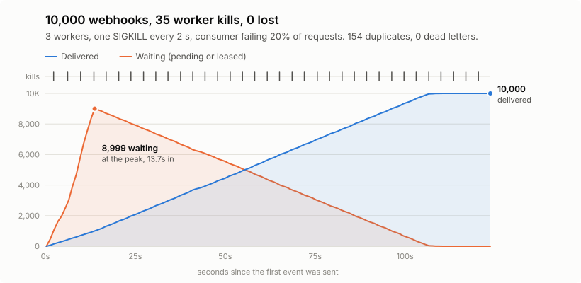
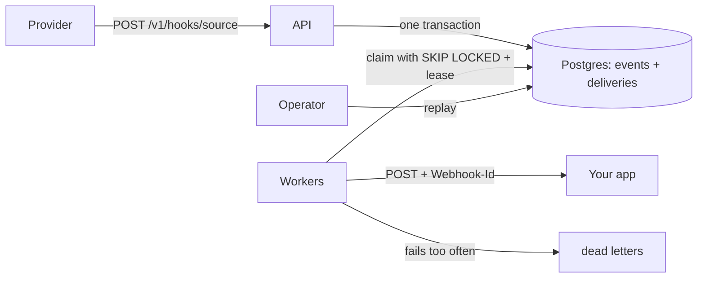

# Webhook Inbox

A self-hosted inbox that doesn't lose your webhooks. It stores each event before acknowledging it,
delivers it to your app with retries, and lets you replay anything that failed.

[](https://github.com/Hameesmahmood/webhook-inbox/actions/workflows/ci.yml)

<picture>
  <source media="(prefers-color-scheme: dark)" srcset="docs/results/chaos-chart-dark.svg">
  
</picture>

**10,000 webhooks sent while 3 workers were killed with `SIGKILL` 35 times: 0 lost, 154 delivered twice.** Every run checks that nothing acknowledged was lost, and fails if anything was.
[Results and how to rerun them](docs/RESULTS.md).

## The problem

Webhooks are fragile. A provider sends an event once, or retries a few times, and if your app is
down, slow or mid-deploy, the event can be gone for good. Handling them inside your app has two
more costs: a slow handler can time out the provider, and a bug leaves you with no copy of what
arrived.

Webhook Inbox sits in front of your app:



1. The API saves the event, and one delivery row per destination, in a single transaction. Only
   then does it reply `202`.
2. Workers claim deliveries, send them to your app and record the result.
3. Failures retry with backoff. After 8 attempts a delivery is set aside as dead, and you can
   replay it once the bug is fixed.

## Try it

You need Docker. Start the stack (Postgres, the API, one worker and a demo consumer):

```bash
docker compose up --build --wait
```

Send a webhook. The `demo` source reads the provider's event ID from the `X-Event-Id` header:

```bash
curl -i localhost:8080/v1/hooks/demo \
  -H 'Content-Type: application/json' -H 'X-Event-Id: order-1001' \
  -d '{"type":"order.paid","order":1001}'
```

```
HTTP/1.1 202 Accepted
{"id":"evt_1"}
```

A worker delivers it to the demo consumer straight away (0.4 s later in the run these outputs came from):

```bash
curl localhost:8081/received
# {"requests":1,"accepted":{"evt_1":1}}
```

Send exactly the same thing again, as a provider retrying would. Nothing new is stored or delivered:

```
HTTP/1.1 200 OK
{"id":"evt_1","duplicate":true}
```

Reuse the key with a different body (`"order":9999`) and the inbox refuses it:

```
HTTP/1.1 409 Conflict
{"title":"Conflict","status":409,"detail":"This idempotency key was already used by evt_1 with a different body.", ...}
```

Look the event up with the admin key (`local-admin-key` in `compose.yaml`; change it with `INBOX_ADMIN_KEY`):

```bash
curl localhost:8080/v1/events/evt_1 -H 'Authorization: Bearer local-admin-key'
```

```json
{
  "id": "evt_1",
  "source": "demo",
  "idempotencyKey": "order-1001",
  "body": "{\"type\":\"order.paid\",\"order\":1001}",
  "deliveries": [
    { "id": "dlv_1", "status": "delivered", "attempts": 1, "lastStatusCode": 200, ... }
  ],
  ...
}
```

Replay it. The consumer gets it a second time, with the same `Webhook-Id`:

```bash
curl -X POST localhost:8080/v1/deliveries/dlv_1/replay -H 'Authorization: Bearer local-admin-key'
# {"id":"dlv_1","status":"pending"}
curl localhost:8081/received
# {"requests":2,"accepted":{"evt_1":2}}
```

Stop everything with `docker compose down --volumes`.

### Run the chaos test yourself

```bash
./scripts/chaos.sh            # 10,000 events, about 2 minutes plus the build
./scripts/chaos.sh 2000       # the size CI runs on every push
python3 scripts/chaos_chart.py  # redraw the chart from the results
```

It starts 3 workers, sends the events, kills a random worker with `SIGKILL` every 2 seconds, waits
for the queue to drain, then compares what the inbox acknowledged with what the consumer received.
It exits non-zero if anything was lost.

## API

Errors use [RFC 9457](https://www.rfc-editor.org/rfc/rfc9457) problem details. Lists use keyset
pagination (`limit` up to 200, `cursor`). Everything except ingest needs
`Authorization: Bearer <admin key>`.

| Method and path | Purpose | Responses |
| --- | --- | --- |
| `POST /v1/hooks/{source}` | Receive a webhook | `202` stored, `200` duplicate, `404` unknown source, `409` key reused with a different body, `413` too large, `503` database down |
| `GET /v1/events` | List events, newest first | `200` |
| `GET /v1/events/{id}` | One event with its body, headers and deliveries | `200`, `404` |
| `GET /v1/deliveries?status=dead` | List deliveries by status | `200` |
| `POST /v1/deliveries/{id}/replay` | Send one delivery again | `202`, `404`, `409` if it's still in progress |
| `POST /v1/deliveries/replay?source=x` | Replay every dead delivery for a source | `202` with a count |
| `GET /v1/stats` | Counts by status, and the age of the oldest due delivery | `200` |
| `GET /healthz`, `GET /readyz` | Liveness, and readiness including the database | `200`, `503` |

Your app receives the original body and content type, plus three headers:

| Header | Meaning |
| --- | --- |
| `Webhook-Id` | The event's ID, the same on every attempt. **Use it to drop duplicates.** |
| `Webhook-Attempt` | 1 on the first try, 2 on the first retry, and so on |
| `Webhook-Source` | The source name from the URL |

Sources, destinations and the admin key are set in configuration. See `compose.yaml` for an example.

## Key decisions

**Store first, then acknowledge.** The `202` goes out only after the commit. Replying first and
saving later loses the event if the process dies in between, and the provider won't resend
something it was told arrived.

**At-least-once, not exactly-once.** A worker can always die after your app accepted an event but
before the worker recorded it. At that point it can resend (a possible duplicate) or give up (a
possible loss). This design always resends, and gives every attempt the same `Webhook-Id` so your
app can drop the repeat. The chaos run measures how often that happens.

**The deliveries table is the outbox.** An event and its delivery rows commit together, so there
is never an event that nothing will deliver.

**Postgres is the queue.** Workers claim batches with `FOR UPDATE SKIP LOCKED`, so they never wait
on each other or take the same row. That means one system to run, not two, and ingest stays a
single transaction. A broker becomes worth it when throughput or many independent consumers
outgrow polling.

**Leases with a fencing token.** A claim gives the worker a lease (30 s by default) and a fresh
random token. A sweep hands expired leases back. Every result is written with
`WHERE lease_token = @token`, so a worker that stalled and lost its job can't overwrite the newer
result. The lease must outlast the HTTP timeout (10 s), and startup refuses settings that break
this.

**Attempts count at claim time.** A message that crashes the worker every time still uses up its
attempts and ends up dead, instead of looping forever.

**Exponential backoff with full jitter.** The wait is a random time between 0 and
`min(5 min, 1 s × 2^attempt)`, and the worker honours `Retry-After` up to the cap. Without jitter,
everything that failed together retries together.

**Only retry what can succeed.** Network errors, timeouts, `408`, `429` and `5xx` retry. Any other
`4xx` goes straight to dead letters, because sending it again won't change the answer.

**Idempotency keys per source.** Each source can name a header holding the provider's event ID.
The same key and body returns `200` with the original event. The same key with a different body
returns `409`, because silently picking one would hide a bug.

## How it's tested

- **96 tests** (xUnit). The integration tests run against real Postgres 18 in Testcontainers, not
  mocks, because the locking behaviour is what's being tested.
- **Each concept has a test that switches it off** and shows what breaks. The naive versions live
  only in the test project:

  | Switched off | What the test shows |
  | --- | --- |
  | Store first | The provider gets `202` for an event that was never saved |
  | Outbox | An event is saved that nothing will ever deliver |
  | Idempotency keys | A resent event is delivered twice |
  | Row locks | Two workers claim the same row |
  | `SKIP LOCKED` | Workers queue behind each other's locks |
  | Leases | A dead worker's job stays stuck forever |
  | Lease token | A slow worker overwrites a newer result |
  | Jitter | Every retry fires at the same moment |
  | Dead letters | A poison message retries forever |

- **The tests were checked by breaking the real code.** 14 deliberate bugs were introduced one at
  a time, and a test failed for every one.
- **The chaos run was checked the same way.** With the worker deliberately broken, a 1,000-event run
  reported 193 lost and failed.
- **CI runs on every push:** the tests, a `docker compose` start-up check, and a 2,000-event chaos
  run that fails the build if anything is lost.

## Honest limits

- **No signature checks.** The inbox doesn't verify provider signatures (HMAC) yet, so anyone who
  can reach `/v1/hooks` can post events. Don't expose it to the internet as it stands.
- **One machine.** The chaos run and every figure here come from Docker on one laptop. They show
  behaviour under failure, not production capacity.
- **No ordering.** Events can reach your app out of order, especially after a retry.
- **A batch waits for its slowest send.** A worker claims up to 10 deliveries and sends them in
  parallel, then claims again only when all of them finish. One destination at its 10 s timeout
  holds up that worker's next batch. Per-destination concurrency would fix it.
- **Replays reuse the ID.** Replaying a delivered event sends the same `Webhook-Id`, so a consumer
  that drops duplicates will ignore it. That's correct for a retry, but awkward if you replay to
  re-run a fixed handler.
- **No retention.** Events are kept forever. There's no clean-up job yet.
- **No UI.** The admin API is the interface.

## Project layout

```
src/WebhookInbox.Core     retry policy, options, Postgres store, SQL migrations
src/WebhookInbox.Api      ingest and admin endpoints
src/WebhookInbox.Worker   claims and delivers
tests/WebhookInbox.Tests  unit tests, plus integration tests on real Postgres (Testcontainers)
tools/WebhookInbox.Sink   demo consumer that fails on demand and records what it got
tools/WebhookInbox.Chaos  the chaos run
```

Built with .NET 10, Npgsql and Dapper. The SQL is written by hand, because the locking is the point.
The [implementation plan](docs/IMPLEMENTATION_PLAN.md) was written before any code.

## Running the tests

```bash
dotnet test        # needs the .NET 10 SDK and Docker (for Testcontainers)
```

## License

MIT
