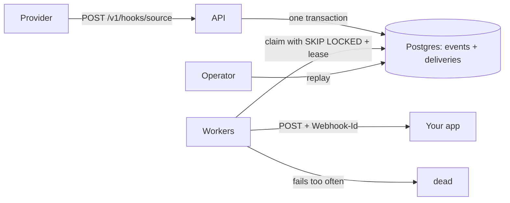

# Implementation plan: Webhook Inbox

## The problem

Webhooks are fragile. A provider sends an event once or a few times, and if your app is down, slow or
mid-deploy, the event can be gone for good. Handling them inside your app also means a slow handler can
time out the provider, and a bug leaves you with no copy of what arrived.

Webhook Inbox sits in front of your app. It stores each event durably before it says "received", then
delivers it to your app with retries. Anything that keeps failing is set aside, and you can replay it
after you fix the bug.

## Non-goals

- Exactly-once delivery. Delivery is at-least-once, and consumers remove duplicates using `Webhook-Id`.
- Ordering. Events can arrive out of order, especially after a retry.
- A web UI. The API is the interface.
- Multi-tenancy, payload transformation and retention or clean-up jobs.
- Provider signature checks (HMAC). This is a stretch goal, so the ingest endpoint must not be exposed
  to the internet as it stands. The README will say so.
- Replacing a broker. Postgres is the queue because one dependency is enough at this scale.

## Design

**Processes.** One Postgres database, an API process and any number of worker processes. The API and
workers are stateless, so a crash loses nothing that was acknowledged.

**Ingest.** The API validates the source and size, then in one transaction inserts the event and one
delivery row per destination. It only returns `202` after that commit. The `deliveries` table is the
transactional outbox: an event can't exist without its deliveries.

**Idempotency.** Each source can name a header that holds the provider's event ID. `(source, key)` is
unique. The same key with the same body returns `200` and the original event. The same key with a
different body returns `409`, because that's a bug worth surfacing. If there's no key, the event is
accepted as new.

**Claiming work.** Workers claim batches with `FOR UPDATE SKIP LOCKED`, so they never wait for each
other or take the same row. A claim sets `status = 'leased'`, a `lease_token` and `lease_expires_at`,
and adds one to `attempts`. Counting at claim time means a message that crashes workers still runs out
of attempts.

**Leases.** A sweep returns expired leases to `pending`, or to `dead` if attempts are used up. The lease
must outlast the HTTP timeout. A worker can only record a result if its `lease_token` still matches, so
a slow worker that lost its lease can't overwrite newer state.

**Retries.** Network errors, timeouts, 408, 429 and 5xx are retried with exponential backoff and full
jitter: `random(0, min(cap, base * 2^attempt))`. `Retry-After` is respected up to the cap. Other 4xx
responses go straight to `dead`, since repeating them won't help.

**Dead letters.** After `MaxAttempts`, a delivery becomes `dead`. It stops being retried and blocks
nothing else. Replay puts it back to `pending` with its attempts reset.

**Delivery status:** `pending -> leased -> delivered | pending (retry) | dead`, and `delivered | dead ->
pending` on replay.

### Data model

- `events`: `id`, `source`, `idempotency_key`, `body_hash`, `payload` (bytea), `headers` (jsonb, with
  `Authorization` and `Cookie` removed), `received_at`. Unique on `(source, idempotency_key)`.
- `deliveries`: `id`, `event_id`, `destination`, `status`, `attempts`, `next_attempt_at`, `lease_token`,
  `lease_expires_at`, `last_status_code`, `last_error`, `delivered_at`. Partial indexes on
  `next_attempt_at` for pending rows and `lease_expires_at` for leased rows.

### API

Errors use `application/problem+json`. List endpoints use keyset pagination (`limit`, `cursor`). Admin
endpoints need `Authorization: Bearer <admin key>`.

| Method and path | Purpose | Responses |
| --- | --- | --- |
| `POST /v1/hooks/{source}` | Receive a webhook | `202` stored, `200` duplicate, `404` unknown source, `409` key reused with a different body, `413` too large |
| `GET /v1/events` | List events | `200` |
| `GET /v1/events/{id}` | Event with its deliveries | `200`, `404` |
| `GET /v1/deliveries?status=dead` | List deliveries | `200` |
| `POST /v1/deliveries/{id}/replay` | Send again | `202`, `404`, `409` if still pending or leased |
| `POST /v1/deliveries/replay?source=x` | Replay all dead deliveries for a source | `202` with a count |
| `GET /v1/stats` | Counts by status, oldest pending age | `200` |
| `GET /healthz`, `GET /readyz` | Liveness, and readiness including the database | `200`, `503` |

Consumers receive the original body plus `Webhook-Id`, `Webhook-Attempt` and `Webhook-Source`.

### Code structure

Small on purpose. There's no layered architecture beyond what the two hosts need to share.

- `src/WebhookInbox.Core`: retry policy, options, Postgres store, SQL migrations.
- `src/WebhookInbox.Api`: minimal API host.
- `src/WebhookInbox.Worker`: background worker host.
- `tests/WebhookInbox.Tests`: unit tests, plus integration tests on real Postgres via Testcontainers.
- `tools/Sink`: a test consumer that fails on demand and records what it received.
- `tools/Chaos`: the load run.

The stack is .NET 10 (LTS), Npgsql and Dapper. SQL is written by hand because the locking is the point
of the project.

## Test plan

Unit tests cover backoff bounds and retry classification. Integration tests run against real Postgres.
Each concept also gets a test that switches it off and shows what breaks. The naive versions live in the
test project, never in production code.

| Concept | With it | Switched off, this breaks |
| --- | --- | --- |
| Store first | `202` only after commit | If the database fails, the provider still gets `202` and the event is gone |
| Outbox | Event and deliveries commit together | A crash between two writes leaves an event nobody delivers |
| Idempotency keys | A resent event is stored once | A resent event is delivered twice |
| `SKIP LOCKED` | Concurrent claims never overlap | Two workers claim the same row |
| Leases | A dead worker's job is picked up again | The job stays stuck forever |
| Lease token | A late result is ignored | A slow worker overwrites a newer result |
| Backoff and jitter | Retries spread out | Failed deliveries all retry at the same moment |
| Dead-letter queue | A poison message stops and others flow | The poison message retries forever |

## The measured result

`tools/Chaos` sends a fixed number of events through a sink that fails at random, while killing workers
on a schedule. When the queue drains, it compares what was acknowledged with what the sink recorded and
reports:

- **Lost:** acknowledged events the sink never accepted. The target is 0.
- **Duplicates:** extra successful deliveries. These are expected from at-least-once delivery, and the
  run reports the real count.
- Throughput and time to drain.

Results go in `docs/RESULTS.md` with the command to rerun them. All of it runs on one machine, so the
figures show behaviour under failure, not production capacity.

## Definition of done

- `docker compose up` starts everything, and the README shows an event going through in under a minute.
- Every row in the test plan table has a passing test.
- CI runs all tests on every push, and every job passes.
- The chaos run is published in `docs/RESULTS.md` with real lost and duplicate counts.
- The README covers the problem, a demo, how to run it, key decisions and honest limits.
- The explain test is passed.

## Schedule

- **Thursday 5 Nov:** this plan, README pitch, skeleton, migrations and CI.
- **Friday 6 Nov:** ingest, idempotency, claiming, leases, delivery and retries.
- **Saturday 7 Nov:** dead letters, replay, inspection endpoints, the sink and the chaos run.
- **Sunday 8 Nov:** results, README, explain test and ship.

If time runs short, cut bulk replay and `GET /v1/stats` first.
