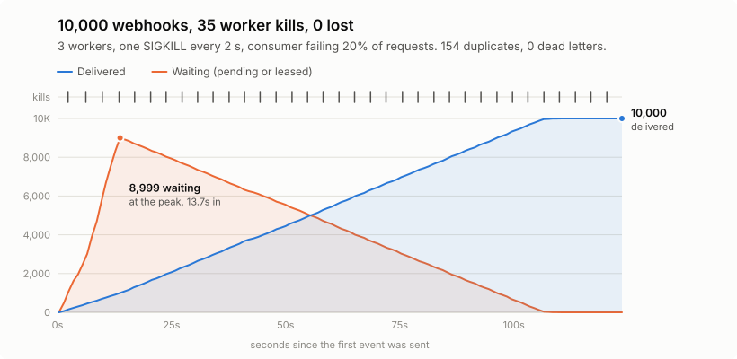

# Results: the chaos run

The question: if workers die mid-delivery, again and again, does any acknowledged webhook get lost?

<picture>
  <source media="(prefers-color-scheme: dark)" srcset="results/chaos-chart-dark.svg">
  
</picture>

## Headline run

Run `6b655ed2`, 10 November 2026. The raw output is in
[`results/chaos-latest.json`](results/chaos-latest.json) and the per-second samples are in
[`results/chaos-latest-timeline.json`](results/chaos-latest-timeline.json).

| Measure | Result |
| --- | --- |
| Events sent and acknowledged | 10,000 |
| Worker kills (`SIGKILL`) | 35 |
| **Lost** (acknowledged, never delivered, not dead-lettered) | **0** |
| **Duplicates** (delivered more than once) | **154**, or 1.5% |
| Dead letters | 0 |
| Requests the consumer received | 12,704 |
| Time to send all 10,000 | 13.4 s |
| Time until the queue was empty | 123.5 s |

**Rerun it:** `./scripts/chaos.sh` (needs Docker and the .NET 10 SDK). It rebuilds the stack, runs
the test and tears everything down. `python3 scripts/chaos_chart.py` redraws the chart from the new
results.

## The setup

Everything runs in Docker Compose on one laptop, with the settings in `compose.chaos.yaml`:

- **3 workers.** A random one is killed with `SIGKILL` every 2 seconds and restarted a second later.
  `SIGKILL` can't be caught, so the worker gets no chance to finish or clean up.
- **A consumer that fails 20% of requests** with `503`, and adds up to 200 ms of random latency.
- **Shorter timings** so failures recover quickly enough to finish in minutes: 5 s leases, 2 s HTTP
  timeout, retries between 200 ms and 3 s, and up to 10 attempts.
- **The sender** posts 10,000 events, 16 at a time, each with its own idempotency key, and resends
  any that fail, as a real provider would.

When the queue has been empty for two checks in a row, the tool compares the list of event IDs the
inbox acknowledged with the IDs the consumer recorded:

- **Lost:** acknowledged, never accepted by the consumer, and not in dead letters.
- **Duplicates:** extra accepted copies of the same `Webhook-Id`.
- **Unexpected:** accepted by the consumer but never acknowledged. This should be impossible, and it was 0.

The run fails if anything is lost or unexpected, or if the queue doesn't drain within 5 minutes.

## Reading the numbers

**Why 154 duplicates and not 0.** A worker can be killed after the consumer accepted an event but
before the worker recorded it. The lease expires, another worker sends the event again, and the
consumer sees it twice. That's the trade the design makes on purpose: resend and maybe duplicate,
instead of giving up and maybe losing. The consumer drops repeats using `Webhook-Id`. That works
out to about 4 duplicates per kill, which fits a worker dying partway through a batch of up to 10.

**Where the 12,704 consumer requests came from.** 10,000 first deliveries, 154 duplicates, and
2,550 requests the consumer refused with `503` (20.1% of all requests, matching its 20% failure
rate). Every refused request was retried and eventually got through, which is why there are no
dead letters.

**The shape of the chart.** Ingest (13.4 s) is far faster than delivery, so the queue builds to
8,999 waiting, then drains at a steady 97 deliveries a second (from 19.7 s to 99.5 s), kills or
not. No kill shows up as a jump, because each one costs only a few seconds of one worker's batch.

**The long tail.** The last delivery took about 12 seconds after the rest. The samples show it
waiting on retry backoff, then held under a lease for 5 seconds starting just after a kill at
116.9 s, which fits a lease expiring and being swept back to another worker. The stack had been
torn down by the time I looked, so this is a reading of the samples, not something I traced.

## Other runs

These are every complete chaos run recorded so far. The counts vary between runs, because the kill
times and consumer failures are random.

| Run | Events | Kills | Lost | Duplicates | Result |
| --- | --- | --- | --- | --- | --- |
| `6b655ed2`, 10 Nov (headline) | 10,000 | 35 | 0 | 154 | Pass |
| `a2d8bcf1`, 9 Nov | 10,000 | 32 | 0 | 110 | Pass |
| CI on commit `b35e9ec`, 9 Nov | 2,000 | 9 | 0 | 27 | Pass |
| `a664954c`, 9 Nov, **worker deliberately broken** | 1,000 | 2 | **193** | 1 | Fail, as it should |

The last row shows the check isn't toothless: with a deliberately broken worker, the same tool
reported 193 lost and failed.

CI runs a 2,000-event version on every push, and uploads the results and timeline as a build
artifact.

## What this doesn't show

- **Production capacity.** One laptop, everything in Docker, a consumer on the same machine. The
  97-per-second figure shows the system working under failure, not how fast it would run on real
  hardware.
- **Database failure.** Only workers are killed. Postgres and the API stay up. The API's `503` path
  when the database is down is covered by tests, not by this run.
- **Network partitions.** Nothing here splits workers from the database while they keep running.

## The data behind the chart

| Seconds | Waiting | Delivered | Kills so far |
| --- | --- | --- | --- |
| 0.3 | 0 | 0 | 0 |
| 9.6 | 5,695 | 687 | 2 |
| 19.7 | 8,434 | 1,566 | 5 |
| 29.8 | 7,455 | 2,545 | 8 |
| 39.9 | 6,460 | 3,540 | 11 |
| 50.0 | 5,551 | 4,449 | 14 |
| 60.1 | 4,550 | 5,450 | 17 |
| 70.2 | 3,545 | 6,455 | 20 |
| 80.3 | 2,559 | 7,441 | 23 |
| 90.4 | 1,573 | 8,427 | 26 |
| 99.5 | 681 | 9,319 | 28 |
| 109.6 | 3 | 9,997 | 31 |
| 119.7 | 1 | 9,999 | 34 |
| 123.7 | 0 | 10,000 | 35 |

"Waiting" is pending plus leased. The full per-second samples are in
[`results/chaos-latest-timeline.json`](results/chaos-latest-timeline.json).
